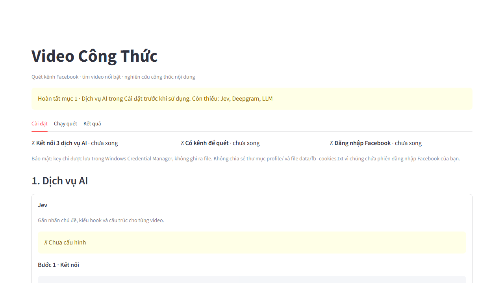
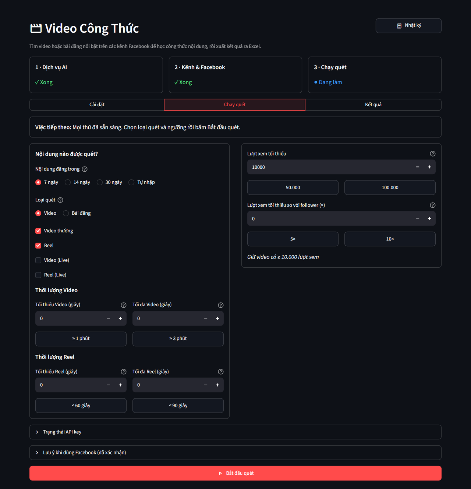
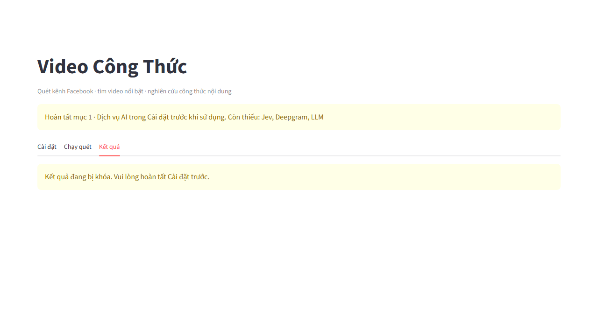

# Video Công Thức — hướng dẫn nhanh

## 1. Mở ứng dụng
Giải nén toàn bộ `VideoCongThuc.zip` vào thư mục có quyền ghi (ví dụ trong Documents), **không chạy trực tiếp trong ZIP**. Mở thư mục `VideoCongThuc`, bấm `VideoCongThuc.exe`; giao diện mở trong cửa sổ ứng dụng riêng (dùng Microsoft Edge có sẵn của Windows), không có cửa sổ đen (console). **Đóng cửa sổ này là tắt ứng dụng** (sau khoảng 15 giây). Máy không cần cài Python hay thư viện gì thêm; cần Internet. Máy có Edge thì không phải tải trình duyệt; máy không có Edge thì **lần đầu mở** ứng dụng tự tải Chromium (khoảng 150 MB, vài phút) vào ngay thư mục ứng dụng trước khi cửa sổ hiện ra. Model chuyển thoại dự phòng (faster-whisper) tự tải vào thư mục `models/` khi cần dùng lần đầu. Nếu ứng dụng không khởi động được, một hộp thoại báo lỗi sẽ hiện ra.

Nếu tải hoặc mở Chromium thất bại, ứng dụng mở trình duyệt mặc định và ghi lỗi vào nhật ký. Nếu không có cửa sổ nào kết nối được trong 2 phút sau khi mở trình duyệt, ứng dụng tự tắt; có thể mở lại sau khi xử lý lỗi.

**Nhật ký:** nút **Nhật ký** ở góc trên bên phải hiện mọi thông báo và lỗi của ứng dụng (mặc định chỉ lỗi và cảnh báo; chọn **Lần mở trước** để xem lỗi của lần chạy trước). Tất cả được ghi vào file `data/app.log`; API key luôn được che. Khi cần hỗ trợ, bấm **Mở file nhật ký** và chỉ gửi file này, không gửi cả thư mục `data/`.

## 2. Trang Cài đặt
- Đầu trang có 3 bước (Dịch vụ AI → Kênh & Facebook → Chạy quét) và dòng **Việc tiếp theo** cho biết cần làm gì tiếp; chỉ cần làm theo dòng này. Mục **1. Dịch vụ AI** có Jev, Deepgram và LLM; dịch vụ đã xong tự thu gọn, dịch vụ chưa xong tự mở. Mỗi dịch vụ làm 2 bước:
  - **Bước 1 · Kết nối**: dán API key (LLM: chọn nhà cung cấp — OpenRouter, OpenAI, Google Gemini, Anthropic (Claude) — hoặc tự nhập endpoint tương thích OpenAI) rồi bấm **Kết nối**. Ứng dụng hỏi thẳng máy chủ của dịch vụ để lấy danh sách model; key sai sẽ báo lỗi ngay. Với Anthropic, dùng API key tạo ở trang Claude Console (bắt đầu bằng `sk-ant-`).
  - **Bước 2 · Chọn model**: chọn model trong danh sách (Deepgram: chọn thêm ngôn ngữ, mặc định tiếng Việt; LLM: gõ để tìm model, giá USD / 1 triệu token hiện kèm nếu nhà cung cấp công bố). Bấm **Kiểm tra và lưu**; kiểm tra có thể phát sinh một lượng phí nhỏ. Key được lưu qua Windows Credential Manager, không ghi vào tệp cấu hình.
- Nhập link trang chính của các page (fanpage) cần quét, mỗi dòng một link (ví dụ `https://www.facebook.com/ten-page`), rồi bấm **Lưu danh sách kênh**. **Không hỗ trợ nhóm (group)**: link nhóm bị báo lỗi khi lưu, và link nhóm đã lưu từ trước bị bỏ qua khi quét. Tên page và khách hàng mục tiêu của page mình (dùng để chấm "làm lại được" và viết gợi ý) nằm ở mục `my_page` trong `config/settings.json`; nhờ người phát triển sửa nếu cần.
- Nếu không đăng nhập được trong cửa sổ của tool, mở mục **Không đăng nhập được? Nạp file cookie** và nạp file cookie xuất bằng tiện ích Cookie-Editor từ tài khoản phụ.
- Bấm **Đăng nhập Facebook**, tự đăng nhập và hoàn tất xác minh trong cửa sổ trình duyệt hiện ra. **Nên dùng tài khoản phụ**, không dùng tài khoản quản trị quan trọng; chỉ thu thập nội dung được phép truy cập và tuân thủ quy định Facebook. Nếu phiên hết hạn hoặc gặp checkpoint, trở lại đây đăng nhập lại.
- Mở **Nhãn phân loại (Jev)** để sửa tên hiển thị, mô tả (nên có ví dụ), thêm hoặc xóa nhãn ở bốn bảng rồi bấm **Lưu nhãn**; mỗi nhóm cần ít nhất hai nhãn, các lựa chọn **Khác / Không có CTA** luôn được giữ. Khi thay đổi nhãn, lần quét tiếp theo Jev sẽ phân loại lại nội dung và có thể phát sinh một khoản phí nhỏ. Muốn quay về bộ nhãn ban đầu, đánh dấu xác nhận rồi bấm **Khôi phục nhãn mặc định**.

## 3. Trang Chạy quét
Trang mở khi đã lưu Jev và LLM; quét video cần thêm Deepgram (chép lời), quét bài đăng thì không. Chọn số ngày và **Loại quét**: **Video** (đánh dấu ít nhất một ô **Video thường**, **Reel**, **Video (Live)**, **Reel (Live)**; mặc định chọn Video thường và Reel, không chọn Live) hoặc **Bài đăng** (bài chữ/ảnh, không gồm video). Với video, đặt **Lượt xem tối thiểu** và/hoặc **Lượt xem tối thiểu so với follower (×)** (5 = lượt xem gấp 5 lần số người theo dõi); khi bật cả hai, chọn **Đạt cả hai điều kiện** hoặc **Đạt một trong hai**. Bài đăng chỉ dùng **Tương tác tối thiểu** (cảm xúc + bình luận + chia sẻ). **Thời lượng Video** và **Thời lượng Reel** đặt riêng cho từng loại (tính bằng giây, có nút nhanh ≥ 1 phút / ≥ 3 phút cho Video, ≤ 60 giây / ≤ 90 giây cho Reel): mục nằm ngoài khoảng bị bỏ trước khi chép lời và phân tích nên không tốn Deepgram/LLM; Video (Live) theo giới hạn của Video, Reel (Live) theo giới hạn của Reel; mục chưa biết thời lượng vẫn được giữ và có ghi chú. Nhập 0 để tắt điều kiện đó; lựa chọn được nhớ cho lần sau. Lần đầu cần đánh dấu **Tôi đã đọc và tự chịu trách nhiệm**, rồi bấm **Bắt đầu quét**.

**Theo dõi tiến độ:** khung **Đang quét** có các bước **Kiểm tra key → Quét kênh → Lọc nội dung → Phân tích → Xuất Excel**, thanh **Tiến độ tổng (ước tính)** và tiến độ bước hiện tại. Bảng **Tiến độ từng kênh** hiện trạng thái, tiến độ, số mục **Tìm thấy**, **Đạt ngưỡng**, **Đã phân tích**; dấu — nghĩa là chưa có số liệu. Quét và phân tích chạy song song nên bước đang hoạt động có thể thay đổi. Khi nghỉ giữa hai kênh hoặc chờ do Facebook giới hạn truy cập, thông báo đếm ngược số giây còn lại. Khung hiện 8 diễn biến gần nhất; mở **Toàn bộ diễn biến lần quét** để xem hết.

Trong lúc quét, tool mở Edge ở ngoài màn hình (vẫn thấy biểu tượng trên thanh tác vụ): không đóng cửa sổ đó. Bấm **Dừng quét** khi cần ngừng; chờ ứng dụng hoàn tất bước hiện tại và lưu phần đã xử lý. Quét xong có nút tải Excel ngay tại chỗ. Nếu key lỗi hoặc hết hạn mức, sửa ở Cài đặt rồi chạy lại; dữ liệu đã xử lý được lưu để dùng lại.

**Số người theo dõi:** tool đọc từ phần đầu trang Facebook, có chờ dữ liệu tải xong. Nếu vẫn báo **chưa đọc được số người theo dõi**, không có nghĩa là kênh có 0 follower: điều kiện tỷ lệ lượt xem/follower không đạt vì thiếu số liệu. Khi chọn **Đạt cả hai điều kiện**, video sẽ bị loại; khi chọn **Đạt một trong hai**, video vẫn có thể qua ngưỡng lượt xem. Nếu chỉ bật tỷ lệ follower thì video không qua lọc; có thể đặt tỷ lệ về 0 và dùng ngưỡng lượt xem.

Khi quét **Bài đăng**, có thể bật **Đọc nội dung ảnh trong bài (AI đọc ảnh)**: tối đa 4 ảnh/bài, tốn thêm khoảng 1.500–2.000 token/ảnh; nội dung được lưu để lần sau không phải đọc lại. Tool kiểm tra model có thực sự nhận ảnh trước khi dùng; nếu không hỗ trợ, đổi model ở Cài đặt (kết quả Excel có cột **Nội dung ảnh** khi đã đọc được ảnh).

**Thời gian:** tùy số kênh, số mục đạt ngưỡng và model AI. Video/bài đạt ngưỡng được phân tích ngay sau khi quét xong kênh đó, trong lúc quét kênh tiếp theo; bài đăng không cần chép lời nên thường nhanh hơn video. **Tab Video xong: thêm 0 video mới** là bình thường khi các video đã có ở tab Reels. Nhiều page chỉ có video dài là **buổi phát trực tiếp đã lưu (Live)**: chúng chỉ được lấy khi đánh dấu **Video (Live)**; nếu chưa chọn, nhật ký ghi rõ **bỏ qua N mục Video (Live) vì chưa chọn Video (Live)**. Video Live chỉ được chép lời 10 phút; nếu mở đầu bằng nhạc chờ, tool tìm đoạn có thoại trong 30 phút đầu. Nếu báo **Không đọc được page**, kiểm tra link và page có công khai không. Nếu báo **trình duyệt của tool đang mở ở nơi khác**, đóng cửa sổ Video Công Thức khác hoặc cửa sổ đăng nhập Facebook rồi quét lại.

**Sử dụng dịch vụ:** số liệu cập nhật khi chạy và giữ lại sau khi kết thúc:
- **LLM:** model, **Lần gọi LLM**, **Token LLM**, token trả về, giây chờ, tốc độ trung bình (token trả về/giây chờ) và số phân tích **Dùng lại**. Thời gian chờ cộng dồn có thể lớn hơn thời gian quét vì các mục chạy song song.
- **Jev:** **Lần gọi Jev**, **Token Jev**. **Deepgram:** **Lần gọi Deepgram**, **Phút Deepgram**.
- **Biểu đồ sử dụng & từng lượt:** token LLM/Jev tích lũy theo thời gian, token và tốc độ LLM từng lượt; bảng ghi token LLM, token trả về, giây chờ, token/giây, token Jev và phút Deepgram cho từng video/bài và lượt **Nhận xét tổng hợp** cuối cùng.

Video/bài đã phân tích trước đó có thể **dùng phân tích LLM đã lưu**, không gọi lại LLM cho phần phân tích đó và không tốn token LLM. Các phần khác, như nhận xét tổng hợp, vẫn có thể phát sinh lần gọi mới.

**Giảm rủi ro tài khoản bị khóa:** tool quét bằng trình duyệt thật, cuộn và nghỉ như người dùng, nghỉ 30–60 giây giữa các kênh, và chỉ dùng cookie tài khoản khi video không xem được ẩn danh. Facebook chủ yếu khóa theo hành vi, nên: dùng tài khoản phụ đã có tuổi và hoạt động bình thường; mỗi lần chỉ quét vài chục kênh, không chạy liên tục nhiều lần trong ngày; không chạy song song trên nhiều máy với cùng tài khoản; không dùng VPN/proxy đổi quốc gia giữa các lần chạy. Gặp checkpoint thì xác minh bằng tay rồi nghỉ vài ngày trước khi quét tiếp.

## 4. Trang Kết quả
Chọn **Xem thống kê file** (mặc định file mới nhất) để xem **Nội dung đã xuất**, **Kênh có kết quả**, **Tổng lượt xem** hoặc **Tổng tương tác**, **Điểm công thức TB** và mức dùng AI của file đó. Mục **Biểu đồ kết quả** có **Top 10 theo lượt xem** hoặc **Top 10 theo tương tác**, **Nội dung theo chủ đề**, **Phân bố điểm công thức**; thiếu số liệu thì không có biểu đồ tương ứng.

Danh sách **File Excel đã xuất** xếp mới nhất trước. Bấm **Tải file Excel** hoặc **Mở thư mục** `output/`. **Xóa file** mở hộp xác nhận ghi tên file: bấm **Xóa** để xóa, **Hủy** để giữ lại. **File đã xóa không thể khôi phục bằng tool**; nếu xóa thất bại vì file đang mở hoặc bị khóa, đóng file trong Excel rồi thử lại.

File `cong-thuc_YYYY-MM-DD_HHmm.xlsx` có 4 trang, theo thứ tự:
- **Tổng quan:** mở đầu báo cáo với **Kết quả lượt chạy** gồm **Số kênh**, **Số video quét được** (hoặc **Số bài đăng quét được**), **Đạt ngưỡng**, **Đã phân tích**, **Số mục xuất**, **Gợi ý giữ lại**, **Video/bài có gợi ý**, **Token Jev**, **Token LLM**, **Phút Deepgram**, **Model LLM**. Có **Phạm vi quét**, **Thời gian chạy**, bảng/biểu đồ **Phân bố chủ đề** và bảng **Nội dung nổi bật** với biểu đồ **Top nội dung theo điểm công thức** (tối đa 10 mục).
- **Chi tiết video** hoặc **Chi tiết bài đăng:** xếp theo điểm công thức, cột chia nhóm màu, bộ lọc ở dòng tiêu đề, link **Mở bài ↗**, thanh màu cho điểm và ô đỏ khi có cờ rủi ro. File bài đăng ẩn cột chỉ dành cho video (lượt xem, thời lượng, thoại).
- **Tổng hợp công thức:** bảng theo nhóm chủ đề, hook và cấu trúc, biểu đồ theo nhóm chủ đề và nhận xét tổng hợp.
- **Nhật ký:** thời gian, tham số đã chọn, số liệu từng kênh, mức dùng dịch vụ và thông báo/lỗi.

**Điểm Jev** là trung bình các điểm hook, cảm xúc, giá trị thực tiễn, khả năng chia sẻ Jev chấm. Đọc **Nhật ký** khi kênh bị bỏ qua hoặc thiếu chỉ số. Kiểm tra gợi ý AI trước khi sử dụng, đặc biệt nội dung sức khỏe và quảng cáo.

## 5. Bảo mật và thay đổi Facebook
Công cụ đọc Facebook tự động qua trình duyệt đã đăng nhập, điều mà [Điều khoản Facebook](https://www.facebook.com/terms) hạn chế khi chưa được phép: tài khoản có thể bị checkpoint hoặc khóa, nên dùng tài khoản phụ, chỉ thu thập nội dung bạn được phép truy cập và tự chịu trách nhiệm (ứng dụng yêu cầu xác nhận một lần trước lần quét đầu).

**Không chia sẻ thư mục `profile/` hoặc `data/`**: chúng chứa phiên đăng nhập/cookie Facebook, cache và dữ liệu riêng. Không gửi API key hay ảnh chụp ô key. Khi cần gửi chương trình cho người khác, gửi bản ZIP sạch do người phát triển cung cấp, không nén lại thư mục đang sử dụng.

Nếu Facebook đổi giao diện hoặc cấu trúc dữ liệu khiến quét không ra video: dừng quét, đóng ứng dụng và sao lưu `config/selectors.json` cùng `config/graphql_paths.json`. Nhờ người phát triển cung cấp bản cập nhật: `selectors.json` chứa bộ chọn giao diện, `graphql_paths.json` chứa đường dẫn tới trường dữ liệu GraphQL. Thay đúng hai tệp trong `config/`, giữ định dạng JSON hợp lệ, mở lại rồi thử một kênh. Không đoán đường dẫn, không gửi cookie/profile để nhờ sửa; nếu chưa có bản cập nhật, gửi file `data/app.log` (API key trong đó đã được che).
