# Video Công Thức — Hướng dẫn sử dụng có ảnh

Dành cho người dùng Windows không cần biết lập trình. Đọc theo thứ tự từ cài đặt đến lần quét đầu tiên; sau đó dùng phần câu hỏi thường gặp để tra cứu.

**Về các hình minh họa:** hình dùng dữ liệu mô phỏng, không phải kết quả hoặc chi phí thực tế. Các vòng đỏ đánh số chỉ vị trí cần chú ý; tên model và số liệu trong máy bạn có thể khác.

## 1. Giới thiệu

### Công cụ giúp bạn làm gì?

Video Công Thức tìm video thường, Reel và bài đăng nổi bật trên các page Facebook; lọc theo thời gian, lượt xem hoặc tương tác; chuyển lời nói thành chữ; phân loại và phân tích cách làm nội dung; cuối cùng xuất báo cáo Excel. Bạn có thể học cách mở đầu, cách triển khai và lời kêu gọi hành động, thay vì chỉ nhìn số lượt xem.

Kết quả AI là tài liệu tham khảo, không phải kết luận chắc chắn. Bạn cần kiểm tra nội dung gốc, quyền sử dụng và độ chính xác trước khi áp dụng ý tưởng.

### Cần chuẩn bị

- Máy **Windows 10 hoặc Windows 11, 64-bit**, kết nối Internet ổn định và dung lượng trống để lưu chương trình, trình duyệt quét và báo cáo.
- Ba API key: **Jev** để gắn nhãn, **Deepgram** để chép lời video và **LLM** để phân tích/viết gợi ý. API key giống mật khẩu cho phép chương trình gọi dịch vụ của bạn. Nếu chỉ quét bài đăng, không cần Deepgram.
- Một **tài khoản Facebook phụ** để đăng nhập khi cần; không nên dùng tài khoản quản trị quan trọng.
- Danh sách địa chỉ các page muốn theo dõi. Công cụ không hỗ trợ nhóm Facebook.
- Microsoft Excel hoặc chương trình đọc được tệp `.xlsx` để xem báo cáo chi tiết.

### Làm quen với màn hình

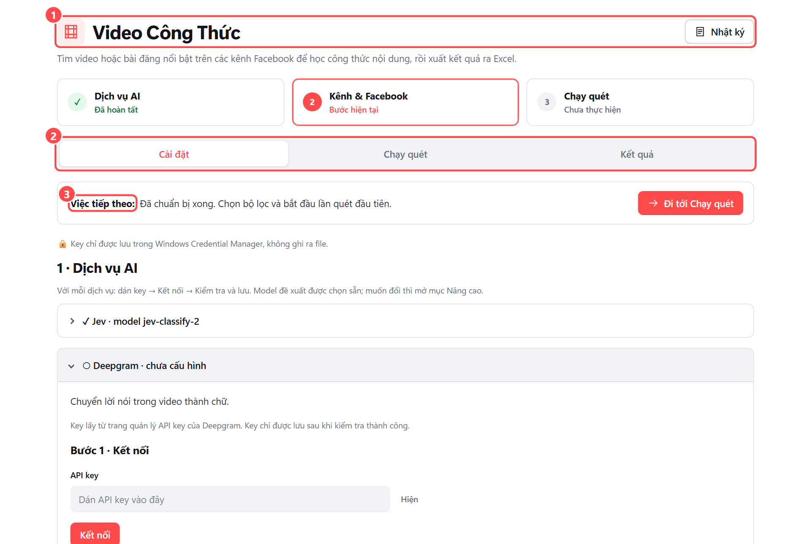

① Tiêu đề và nút Nhật ký ② Các tab Cài đặt, Chạy quét, Kết quả ③ Thanh chỉ việc tiếp theo.

Ba bước phía trên giúp bạn đi đúng thứ tự: dịch vụ AI → kênh và Facebook → chạy quét. Chuyển trang bằng các tab **Cài đặt**, **Chạy quét**, **Kết quả**. Thanh **Việc tiếp theo:** nhắc việc còn thiếu; nút bên cạnh đưa bạn đến trang phù hợp. Không cần nhớ tất cả thiết lập ngay lần đầu.

## 2. Cài đặt

### Cách khuyên dùng: bộ cài Setup

1. Nhận tệp `VideoCongThuc-Setup.exe` từ nguồn phát hành đáng tin cậy. Dung lượng khoảng **90 MB**, có thể thay đổi theo phiên bản. Người dùng bản đóng gói **không cần cài Python**.
2. Đóng Video Công Thức nếu đang mở, rồi bấm đúp bộ cài.
3. Nếu Windows hiện **Windows protected your PC**, chỉ khi đã kiểm tra đúng nguồn phát hành, bấm **More info** rồi **Run anyway**. Cảnh báo này có thể xuất hiện vì bộ cài chưa ký số; không có nghĩa mọi tệp cùng tên đều an toàn. Nếu công ty chặn chạy, liên hệ quản trị viên thay vì tắt bảo vệ máy.
4. Làm theo các màn hình của bộ cài. Ứng dụng cài cho tài khoản Windows hiện tại, **không cần quyền quản trị**. Thư mục mặc định là `%LOCALAPPDATA%\Programs\VideoCongThuc`.
5. Giữ tùy chọn tạo biểu tượng Desktop nếu muốn mở nhanh. Sau cài đặt, mở từ Start menu hoặc biểu tượng Desktop. Start menu cũng có lối tắt hướng dẫn PDF.

### Nếu máy thiếu WebView2

Ứng dụng cần **Microsoft Edge WebView2 Runtime** để hiển thị cửa sổ. Thành phần này thường đã có trên Windows 10/11. Nếu ứng dụng báo thiếu, tải từ [Microsoft Edge WebView2 Runtime](https://go.microsoft.com/fwlink/p/?LinkId=2124703), cài Runtime rồi mở lại. Đây là thành phần khác với trình duyệt dùng để quét Facebook.

### Cách thay thế: bản ZIP không cần cài

1. Nhận `VideoCongThuc.zip` (khoảng **123 MB**).
2. Bấm chuột phải → **Extract All** (Giải nén tất cả). Chọn thư mục bạn có quyền ghi, ví dụ trong Documents.
3. Mở thư mục đã giải nén, bấm `VideoCongThuc.exe`. **Không chạy từ bên trong ZIP; không chép riêng tệp EXE ra ngoài**. Giữ nguyên thư mục `app/` cùng các tệp đi kèm.
4. Nếu báo chưa giải nén đầy đủ, giải nén lại toàn bộ bản ZIP sạch. Không tải các DLL rời từ nguồn lạ.

### Nâng cấp và gỡ cài đặt

**Nâng cấp bản Setup:** nên sao lưu dữ liệu trước, sau đó chạy bộ cài mới lên bản cũ. Bộ cài yêu cầu đóng ứng dụng, thay `app/` nhưng giữ `config/`, `data/`, `output/`, `profile/`. Chờ cài xong rồi mở lại; không chép tệp vào chương trình khi đang quét.

**Gỡ cài đặt:** vào Windows **Settings → Apps**, tìm Video Công Thức và chọn gỡ. Bốn thư mục `config/`, `data/`, `output/`, `profile/` **luôn được giữ**, nên gỡ ứng dụng không đồng nghĩa xóa cookie hay dữ liệu cá nhân. Nếu muốn xóa hẳn, sao lưu thứ cần giữ, kiểm tra đúng thư mục còn lại rồi tự xóa sau khi gỡ.

Với bản ZIP, giữ bản cũ như một bản sao lưu và dùng bản mới đã giải nén đầy đủ. Nếu cần chuyển dữ liệu, đóng cả hai bản trước khi sao chép bốn thư mục dữ liệu; không chạy hai bản cùng phiên Facebook.

## 3. Lần đầu mở ứng dụng

1. Mở Video Công Thức và chờ cửa sổ hiện đủ nội dung.
2. Trình duyệt quét được chuẩn bị tự động. Máy có Edge thường dùng được ngay; nếu cần Chromium, ứng dụng tự tải và hiện thông báo chuẩn bị. Lần đầu có thể mất khoảng một phút hoặc lâu hơn tùy mạng. Chờ hoàn tất trước khi đăng nhập hoặc quét.
3. Ở thẻ chào mừng, đọc danh sách cần chuẩn bị. Bấm **Bắt đầu thiết lập** để làm lần lượt. Nút **Mở hướng dẫn có ảnh (PDF)** mở tài liệu này.
4. Kết nối các dịch vụ, lưu kênh và đăng nhập tài khoản phụ theo các phần dưới.

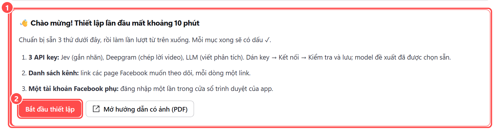

① Danh sách chuẩn bị cho lần đầu ② Nút Bắt đầu thiết lập.

**Đóng cửa sổ là thoát ứng dụng.** Nếu đang quét, ứng dụng hỏi trước khi đóng. Nên dùng **Dừng quét** rồi chờ lưu phần đã xử lý, thay vì đóng cửa sổ ngay.

## 4. Lấy API key

### Jev — gắn nhãn

1. Đăng nhập tài khoản **Jev/typesafe** mà bạn được cấp hoặc đang sử dụng.
2. Mở phần quản lý API key trong tài khoản Jev; tạo key nếu chưa có.
3. Sao chép key để dán vào dịch vụ Jev trong ứng dụng. Nếu không thấy mục cấp key hoặc chưa có tài khoản, hỏi đơn vị cung cấp tài khoản Jev; không dùng key của Deepgram hay LLM thay thế.

Địa chỉ và quyền cấp key phụ thuộc tài khoản Jev/typesafe của bạn; tài liệu không đoán một đường dẫn cấp key chưa được xác nhận.

### Deepgram — chuyển lời nói thành chữ

1. Mở [console.deepgram.com](https://console.deepgram.com), đăng ký hoặc đăng nhập.
2. Chọn đúng dự án nếu tài khoản có nhiều dự án.
3. Mở **API Keys** → **Create a New API Key**.
4. Đặt tên dễ nhớ, ví dụ `VideoCongThuc`, tạo key rồi sao chép. Một số dịch vụ chỉ hiện đầy đủ key một lần, nên làm tiếp phần kết nối ngay.
5. Tài khoản mới có thể được cấp credit miễn phí theo chính sách Deepgram. Kiểm tra số dư và hạn mức trong trang quản lý; không mặc định rằng credit sẽ dùng mãi.

### LLM — chọn một nhà cung cấp

Bạn chỉ cần key của **một** nhà cung cấp LLM. Tài khoản trò chuyện trả phí không nhất thiết bao gồm tiền dùng API.

| Nhà cung cấp | Các bước lấy key | Chọn trong ứng dụng |
| --- | --- | --- |
| OpenRouter | 1. Đăng nhập [openrouter.ai/keys](https://openrouter.ai/keys). 2. Tạo key mới. 3. Đặt hạn mức nếu có và sao chép key. | OpenRouter |
| OpenAI | 1. Đăng nhập [platform.openai.com/api-keys](https://platform.openai.com/api-keys). 2. Chọn dự án. 3. Tạo secret key mới và sao chép. Kiểm tra thanh toán API của dự án. | OpenAI |
| Google Gemini | 1. Mở [aistudio.google.com/apikey](https://aistudio.google.com/apikey). 2. Đăng nhập Google. 3. Tạo API key cho dự án phù hợp rồi sao chép. | Google Gemini |
| Anthropic | 1. Mở [console.anthropic.com/settings/keys](https://console.anthropic.com/settings/keys). 2. Đăng nhập Claude Console. 3. Tạo key mới rồi sao chép key bắt đầu bằng `sk-ant-`. | Anthropic (Claude) |
| Dịch vụ khác | 1. Vào trang quản lý của nhà cung cấp. 2. Lấy API key. 3. Lấy địa chỉ API tương thích OpenAI do nhà cung cấp công bố, thường kết thúc bằng `/v1`. | Khác (tự nhập) |

### Lưu ý về chi phí

- Chi phí dịch vụ AI tách biệt với chương trình. Giá và ưu đãi thay đổi theo nhà cung cấp, model và thời điểm.
- Deepgram thường tính theo lượng âm thanh; Jev/LLM theo lượt hoặc token (đơn vị đo văn bản của AI). Chép lời video dài và phân tích nhiều mục có thể tốn hơn.
- **Kiểm tra và lưu** có thể gọi thử dịch vụ, phát sinh một lượng phí nhỏ. Nên thử một kênh trước, kiểm tra số dư và đặt hạn mức ở nhà cung cấp.
- Số liệu sử dụng trong ứng dụng giúp theo dõi lượng dùng, **không phải hóa đơn tiền chính xác**. Đối chiếu hóa đơn tại nhà cung cấp.

## 5. Cài đặt dịch vụ AI

### Nguyên tắc chung: kết nối rồi kiểm tra và lưu

Mở tab **Cài đặt**, tìm **1 · Dịch vụ AI**. Bấm dòng tên dịch vụ để mở hoặc thu gọn. Dấu ✓ cho biết đã cấu hình; dòng chưa cấu hình cần làm tiếp.

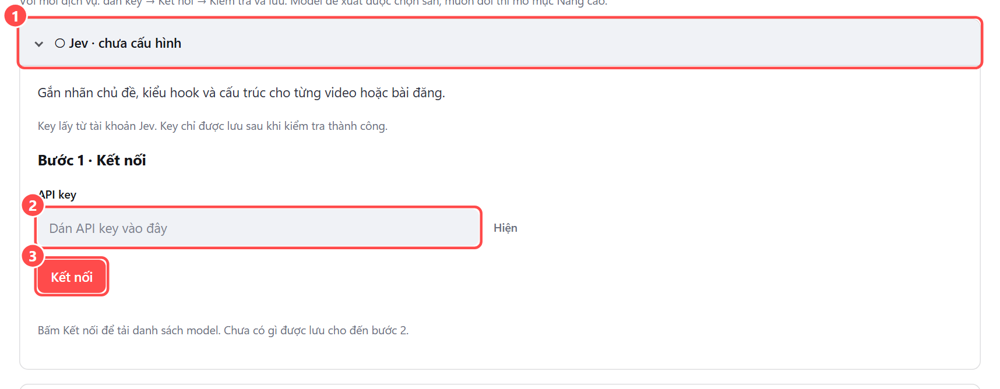

① Dòng tên để mở/thu gọn ② Ô API key ③ Nút Kết nối.

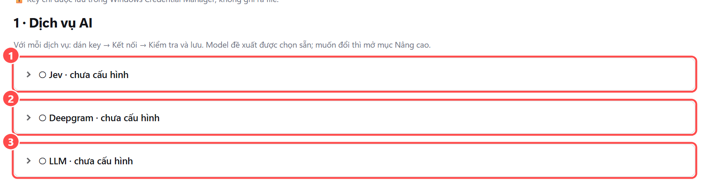

① Jev ② Deepgram ③ LLM; mở từng dòng để cấu hình.

1. Mở dịch vụ cần dùng.
2. Ở **Bước 1 · Kết nối**, dán key vào **API key**. Ô được che để hạn chế lộ key; không chụp ảnh lúc hiện key.
3. Bấm **Kết nối** và chờ tải danh sách model. **Lúc này key chưa được lưu**.
4. Ở **Bước 2 · Kiểm tra và lưu**, xem dòng **Model sẽ dùng:**. Nếu có nhãn **Đề xuất**, thông thường giữ nguyên lựa chọn này.
5. Chỉ mở phần nâng cao nếu cần đổi model. Bấm **Kiểm tra và lưu**, chờ thông báo thành công và dịch vụ có dấu ✓.
6. Nếu lỗi, đọc thông báo, kiểm tra key/nhà cung cấp/số dư rồi thử lại. Không bấm liên tiếp khi ứng dụng đang xử lý.

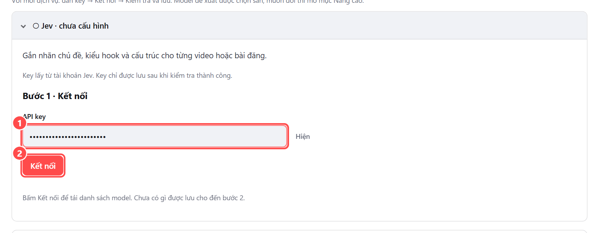

① Ô dán API key (dữ liệu minh họa, không phải key thật) ② Nút Kết nối.

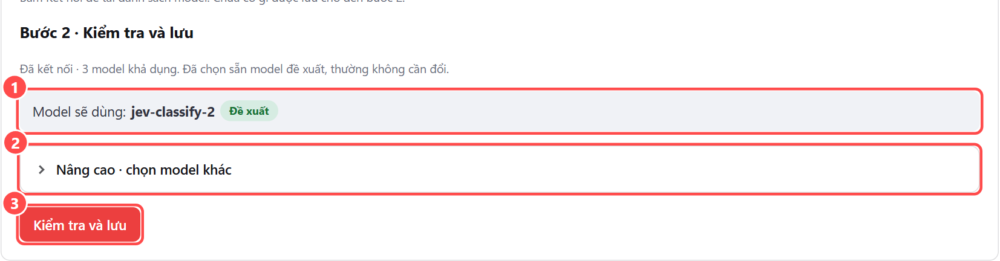

① Model được chọn sẵn và nhãn Đề xuất ② Nâng cao · chọn model khác đang thu gọn ③ Kiểm tra và lưu.

Key chỉ lưu trong **Windows Credential Manager**, không ghi vào tệp cấu hình. Khi đã có key lưu, bạn có thể để ô key trống để kết nối lại bằng key đó. Đổi máy hoặc đổi tài khoản Windows có thể cần nhập lại key.

### Jev

Thực hiện đủ hai bước trên. Jev gắn nhãn chủ đề, hook, cấu trúc và CTA. Giữ model đề xuất nếu chưa có nhu cầu cụ thể. **Hook** là cách mở đầu để thu hút người xem; **CTA** là lời kêu gọi người xem làm một việc, ví dụ bình luận hoặc theo dõi.

### Deepgram và ngôn ngữ thoại

Deepgram cần khi quét video. Dán key → **Kết nối** → xem model đề xuất → **Kiểm tra và lưu**.

Nếu cần kiểm tra ngôn ngữ, mở **Nâng cao · model và ngôn ngữ**:

- Bật **Tự nhận biết tiếng Việt / tiếng Anh** để chọn ngôn ngữ theo từng video. Đây là cách thuận tiện khi danh sách có cả tiếng Việt và tiếng Anh.
- Khi độ tin cậy thấp, chương trình có thể chép lại bằng tiếng Việt; hai lượt chép đều có thể tính phí.
- Nếu chỉ muốn một ngôn ngữ cố định, tắt tự nhận biết rồi chọn **Ngôn ngữ thoại (khi tắt tự nhận biết)**.
- Thoại tiếng Anh được LLM dịch thêm sang tiếng Việt trong cột **Thoại dịch tiếng Việt**. Cột **Nội dung thoại** giữ lời gốc; dịch thuật có thể tốn thêm token LLM. Bản thoại/bản dịch đã lưu được dùng lại khi phù hợp.

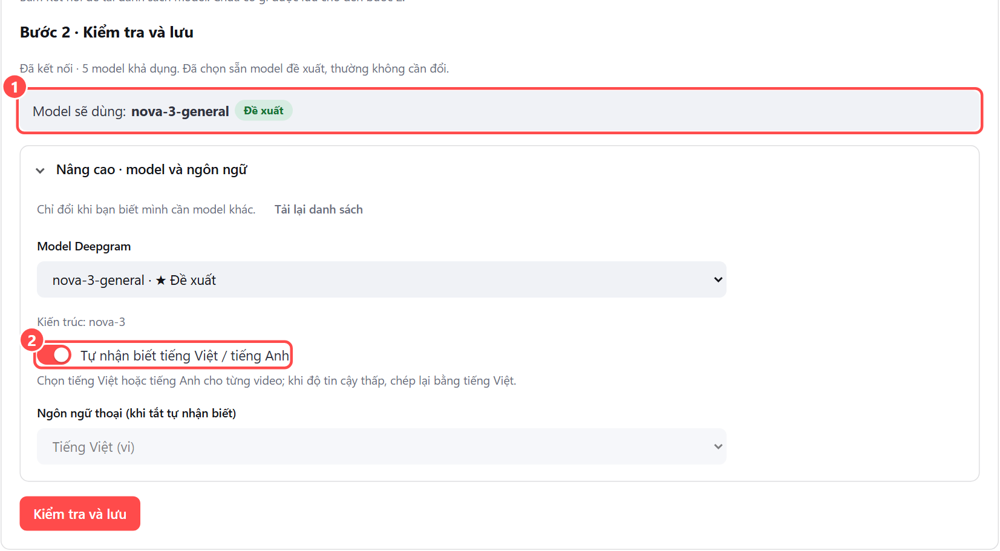

① Model sẽ dùng ② Công tắc tự nhận biết tiếng Việt / tiếng Anh trong phần nâng cao.

Nếu Deepgram hết credit/hạn mức, các video đó **không có bản chép lời**. Nạp thêm hoặc đổi key Deepgram trong Cài đặt rồi quét lại; xem bảng xử lý lỗi ở cuối tài liệu.

### LLM và nhà cung cấp

1. Mở dịch vụ **LLM**.
2. Chọn **Nhà cung cấp** đúng với nơi cấp key. Nếu chọn **Khác (tự nhập)**, nhập **Địa chỉ endpoint** do nhà cung cấp đưa; không nhập địa chỉ trang trò chuyện.
3. Dán key, bấm **Kết nối**. Với một số dịch vụ, tải được model chưa chứng minh key hợp lệ.
4. Giữ model đề xuất hoặc mở **Nâng cao · chọn model khác**. Có thể gõ tên để tìm model. Giá hiển thị nếu nhà cung cấp công bố là USD/1 triệu token.
5. Bấm **Kiểm tra và lưu** để xác thực và lưu thật sự.

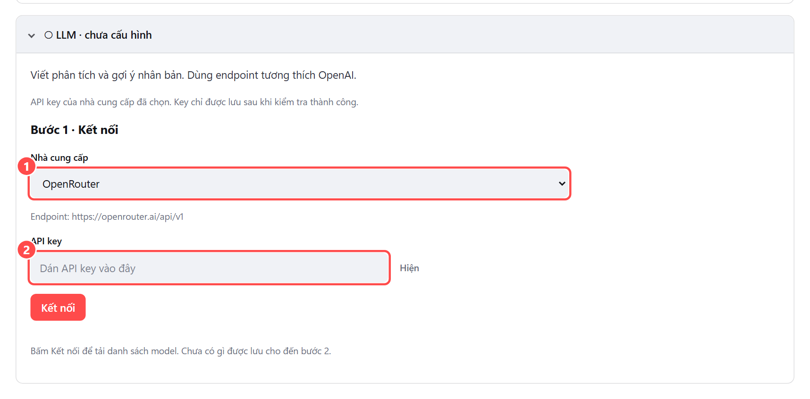

① Nhà cung cấp phải khớp key ② Ô API key của nhà cung cấp đó.

## 6. Kênh & Facebook

### Lưu các page cần quét

Trong **2 · Kênh & Facebook**, tìm **Kênh cần quét**:

1. Dán địa chỉ trang chính của từng page vào **Danh sách link kênh**, **mỗi dòng một địa chỉ**.
2. Ví dụ một dòng: `https://www.facebook.com/ten-page`. Không dùng link một bài cụ thể thay link page.
3. Dòng bắt đầu bằng `#` là ghi chú, không được quét. Ví dụ `# Nhóm page tham khảo tháng này`.
4. Không nhập link nhóm Facebook: nhóm không được hỗ trợ. Sửa các dòng lỗi được báo.
5. Bấm **Lưu danh sách kênh**. Nếu chỉ gõ mà chưa lưu, đừng coi danh sách mới là đã có hiệu lực.

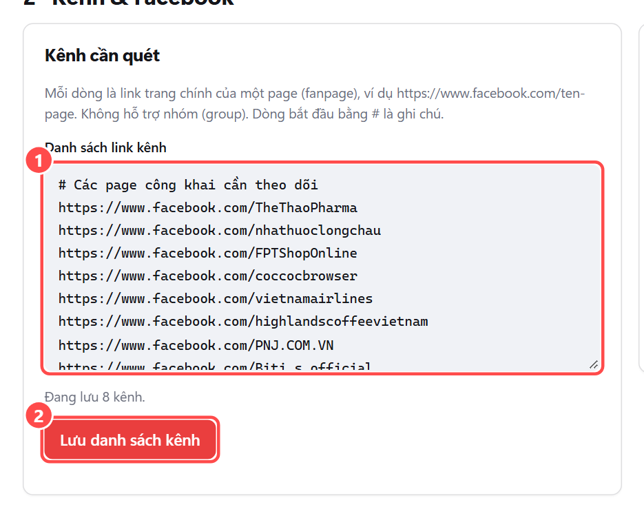

① Mỗi dòng một link page ② Lưu danh sách kênh để áp dụng.

### Đăng nhập bằng tài khoản phụ

1. Ở thẻ **Đăng nhập Facebook**, bấm **Đăng nhập Facebook** khi chưa đăng nhập; nếu đã có phiên, nút là **Đăng nhập lại**.
2. Cửa sổ trình duyệt mở ra. Tự nhập tài khoản phụ và hoàn tất các bước xác minh của Facebook. Không gửi mật khẩu cho người hỗ trợ.
3. Khi đăng nhập xong, đóng cửa sổ đăng nhập để ứng dụng kiểm tra và lưu phiên.
4. Kiểm tra trạng thái **Đã đăng nhập**. Phiên được dùng lại cho lần sau; hết phiên thì đăng nhập lại.

### Nếu không đăng nhập được trong cửa sổ của ứng dụng

1. Đăng nhập tài khoản phụ trong trình duyệt thông thường.
2. Dùng Cookie-Editor trên trình duyệt đó để xuất cookie của `facebook.com` ra tệp JSON hoặc TXT.
3. Mở **Không đăng nhập được? Nạp file cookie**.
4. Bấm **Chọn file cookie…**, chọn tệp trong hộp thoại Windows rồi mở. Kiểm tra trạng thái sau khi nạp.

Cookie có thể cho phép truy cập tài khoản như một phiên đăng nhập. Không tải cookie lên website lạ, không gửi cho người khác và không đưa vào ảnh chụp.

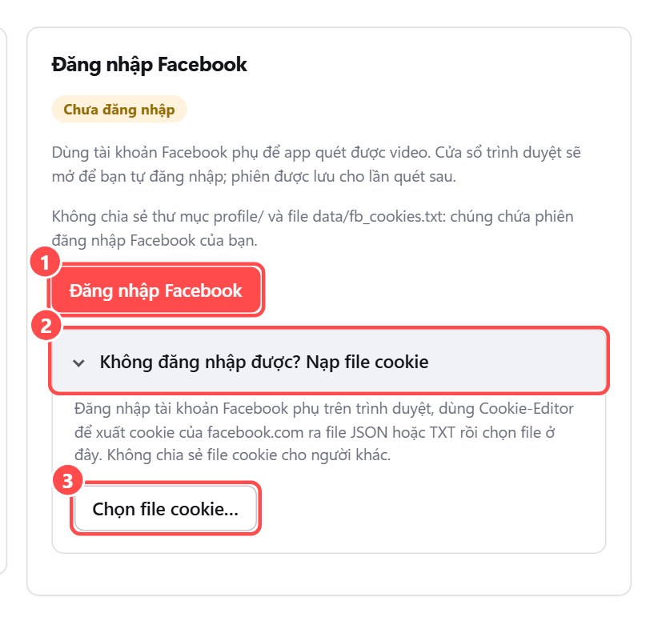

① Đăng nhập Facebook ② Mở cách nạp cookie khi cần ③ Chọn file cookie…

### Nhãn phân loại (tùy chọn)

Bạn có thể giữ mặc định để bắt đầu. Mở **Nhãn phân loại (Jev)** nếu muốn điều chỉnh cách gom nội dung. Jev chọn đúng một nhãn trong mỗi nhóm: **Nhóm chủ đề**, **Kiểu hook**, **Cấu trúc**, **CTA**.

- **Tên hiển thị** là chữ trong Excel; đổi tên không làm Jev chấm lại.
- **Mô tả cho Jev** cần cụ thể, có ví dụ và ranh giới với nhãn gần giống. Mô tả mơ hồ dễ có kết quả chưa chắc.
- Mỗi nhóm cần ít nhất hai nhãn; các nhãn cố định được giữ. Đừng tạo quá nhiều nhãn khiến mỗi nhóm chỉ có một vài nội dung.
- Sau khi thêm/xóa/sửa mô tả, bấm **Lưu nhãn**. Lần quét tiếp theo Jev chấm lại nội dung, có thể tốn thêm phí. Nhãn không thay đổi ngưỡng lượt xem.

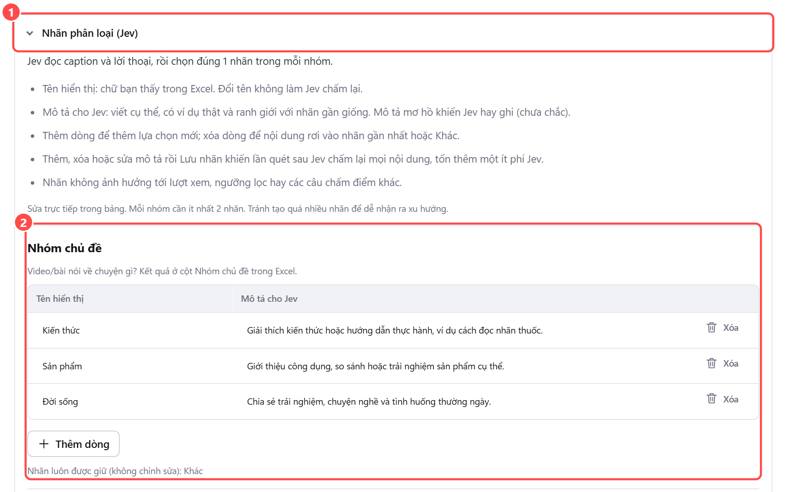

① Tiêu đề phần nhãn ② Bảng nhóm chủ đề để sửa tên và mô tả.

## 7. Chạy quét

### Chọn nội dung và thời gian

Mở **Chạy quét**. Nếu hiện **Chạy quét đang khóa**, trở về Cài đặt để kết nối và lưu Jev, LLM. Quét video cần Deepgram; quét bài đăng không cần dịch vụ chép lời.

1. Trong **Nội dung nào được quét?**, chọn **Nội dung đăng trong**: **7 ngày**, **14 ngày**, **30 ngày** hoặc **Tự nhập** rồi nhập **Số ngày**. Đây là khoảng ngày đăng tính về trước, không phải số ngày chương trình chạy.
2. Chọn **Loại quét** là **Video** hoặc **Bài đăng**. Bài đăng là nội dung chữ/ảnh, không gồm video.
3. Với Video, chọn ít nhất một loại: **Video thường**, **Reel**.
4. Đặt **Thời lượng Video** và **Thời lượng Reel** riêng, bằng giây. **Tối thiểu (giây)** là giới hạn dưới, **Tối đa (giây)** là giới hạn trên; **0 = không giới hạn** cho phía tương ứng.
5. Ví dụ muốn video từ một đến ba phút: tối thiểu 60, tối đa 180. Muốn Reel tối đa một phút: tối thiểu 0, tối đa 60. Có nút đặt nhanh bên dưới từng loại.

Nội dung ngoài khoảng thời lượng được bỏ trước khi chép lời/phân tích, giúp giảm phí. Nếu chưa biết thời lượng, mục đó vẫn có thể được giữ và có ghi chú.

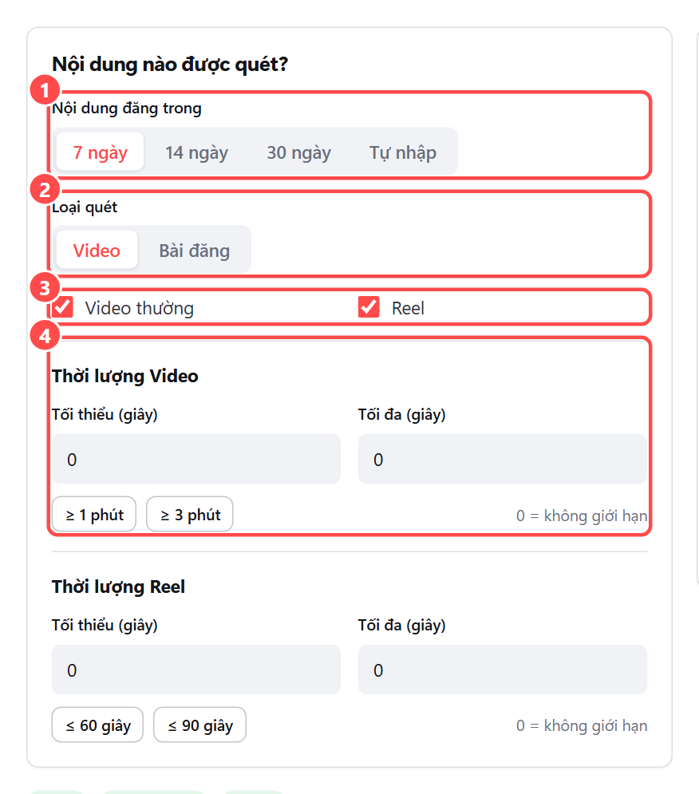

① Khoảng ngày đăng ② Loại quét ③ Video thường/Reel ④ Giới hạn thời lượng theo giây.

### Hiểu ngưỡng lọc qua ví dụ

| Tùy chọn | Ý nghĩa | Ví dụ |
| --- | --- | --- |
| Lượt xem tối thiểu | Video cần đạt số lượt xem này; 0 là không lọc theo ngưỡng này. | Nhập 10000 để giữ video từ 10.000 lượt xem. |
| Lượt xem so với follower (×) | So lượt xem với người theo dõi của page; 0 là tắt. | Page có 2.000 follower; ngưỡng 5× đòi ít nhất 10.000 lượt xem. |
| Đạt cả hai điều kiện | Khi bật cả hai ngưỡng, phải đạt đồng thời (AND). | 20.000 lượt xem và 5×: page 5.000 follower cần ít nhất 25.000 lượt xem. |
| Đạt một trong hai | Khi bật cả hai ngưỡng, chỉ cần đạt một ngưỡng (OR). | Với ví dụ trên, 20.000 lượt xem đã đủ dù chưa đạt 5×. |
| Tương tác tối thiểu | Chỉ dùng cho Bài đăng: tổng cảm xúc + bình luận + chia sẻ; 0 là không lọc. | 80 cảm xúc + 15 bình luận + 5 chia sẻ = 100 tương tác. |

**Thiếu số liệu không có nghĩa là bằng 0.** Nếu không đọc được lượt xem/follower, điều kiện tương ứng không đạt. Khi yêu cầu cả hai, thiếu follower có thể làm video bị loại. Khi chọn một trong hai, video vẫn có thể qua ngưỡng lượt xem. Nếu cần, tắt tỷ lệ follower bằng 0 và dùng ngưỡng lượt xem phù hợp.

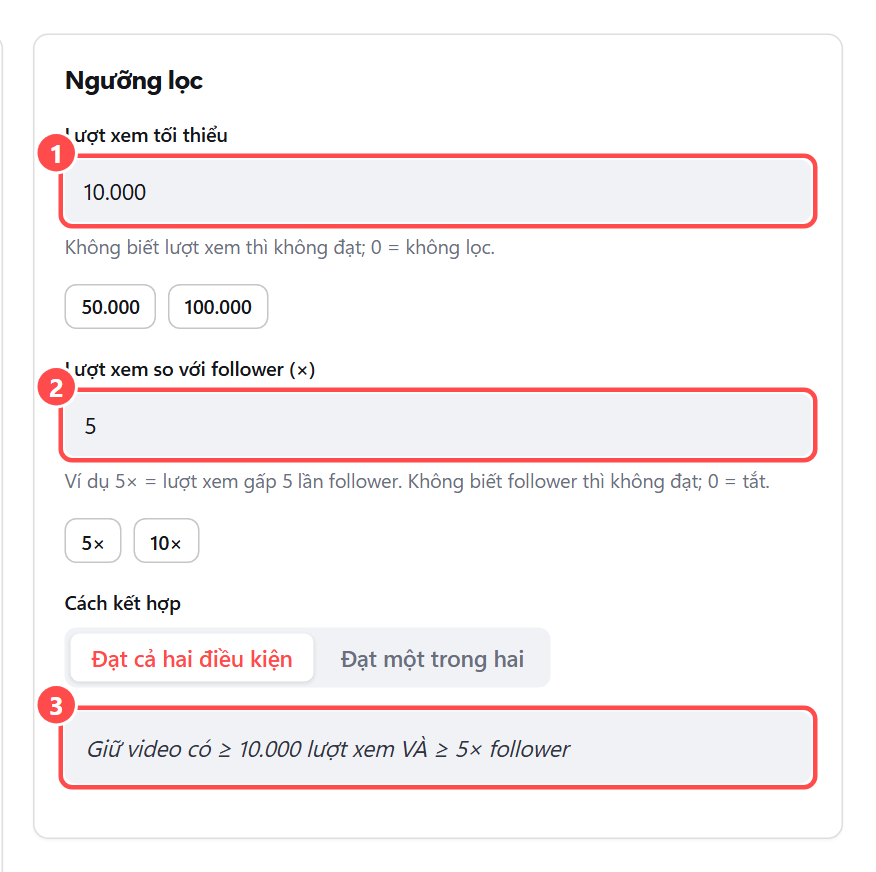

① Ngưỡng lượt xem ② Ngưỡng so với follower ③ Dòng tóm tắt để kiểm tra lựa chọn.

Khi quét bài đăng, có thể bật **Đọc nội dung ảnh trong bài (AI đọc ảnh)**: tối đa bốn ảnh mỗi bài, khoảng 1.500–2.000 token/ảnh. Model LLM cần hỗ trợ ảnh; ứng dụng kiểm tra trước khi dùng. Nội dung ảnh đã đọc được lưu để dùng lại, và có thể xuất vào cột **Nội dung ảnh**.

### Kiểm tra trước khi bấm bắt đầu

1. Đọc dòng tóm tắt: loại nội dung, ngày và các ngưỡng có đúng ý bạn không? Sửa lỗi được báo, chẳng hạn thiếu loại video hoặc khoảng thời lượng không hợp lệ.
2. Kiểm tra các dấu key Jev, Deepgram, LLM. Bấm **Kiểm tra lại** nếu vừa sửa dịch vụ. Key có dấu lỗi cần sửa ở Cài đặt; đừng tìm cách bỏ qua kiểm tra.
3. Lần đầu, đọc **Lưu ý quan trọng trước khi quét** và chỉ đánh dấu **Tôi đã đọc và tự chịu trách nhiệm** khi đồng ý. Sau khi xác nhận, phần lưu ý được thu gọn và ghi thời điểm xác nhận.
4. Bấm **Bắt đầu quét**. Lần thử đầu chỉ nên dùng một vài kênh và khoảng 7 ngày để làm quen chi phí, thời gian.

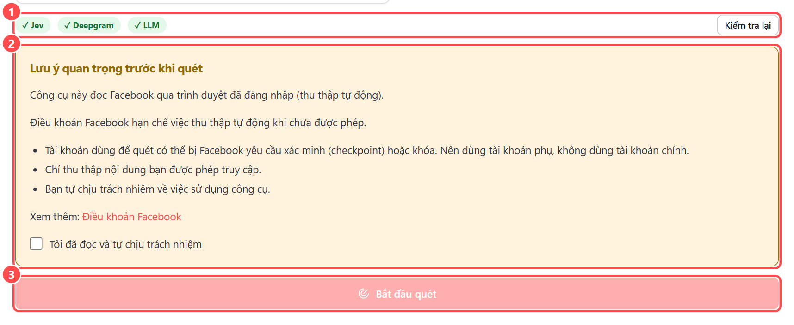

① Trạng thái key ② Lưu ý và ô xác nhận lần đầu ③ Nút Bắt đầu quét phía dưới.

### Theo dõi khi đang quét

Khung **Đang quét** chia thành hai ô chạy song song, mỗi ô có thanh tiến độ và việc đang làm riêng:

- **1 · Quét Facebook:** số kênh đã quét xong (ví dụ `1/3 kênh`), tab và lần cuộn hiện tại, thời gian nghỉ còn lại giữa hai kênh và link page đang quét. Trong lúc nghỉ, ứng dụng đồng thời bổ sung số liệu còn thiếu (yt-dlp) của kênh vừa quét.
- **2 · Phân tích AI:** số mục đã phân tích trên số mục đạt ngưỡng (ví dụ `8/14 video`) và mục đang chép lời/phân tích. Ô này bắt đầu khi kênh đầu tiên có mục đạt ngưỡng; hiện **Chờ kênh tiếp theo** khi đã phân tích hết phần hiện có.

**Tiến độ tổng (ước tính)** chỉ là ước tính, không phải giờ kết thúc bảo đảm. Lúc kiểm tra key và xuất Excel, dòng thông báo chung hiện phía trên hai ô.

Bảng **Tiến độ từng kênh** cho biết kênh nào đang làm, follower, số mục tìm thấy, đạt ngưỡng và đã phân tích. Dấu — là chưa có số liệu, không phải số 0. Dùng **Mở kênh** khi muốn đối chiếu page gốc.

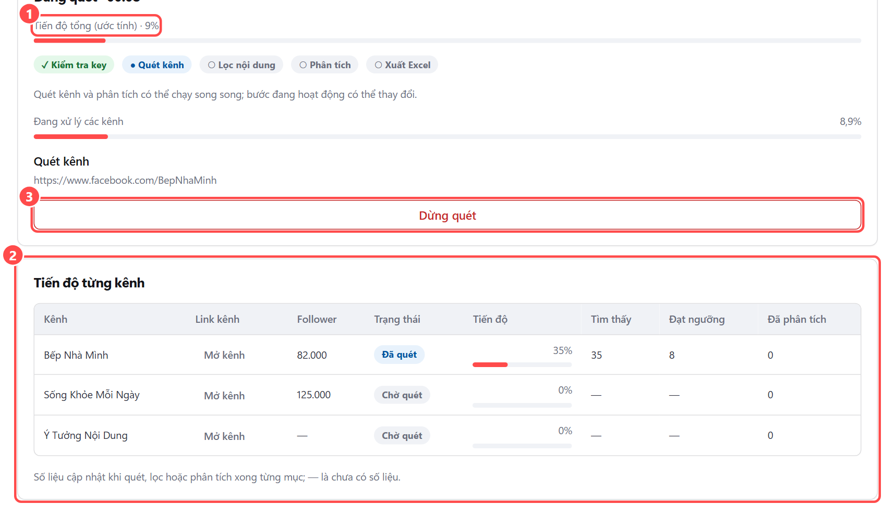

① Hai ô Quét Facebook / Phân tích AI ② Bảng từng kênh ③ Dừng quét khi cần.

**Ứng dụng cố ý nghỉ 30–60 giây giữa các kênh để giảm rủi ro bị chặn.** Thời gian chờ này không có nghĩa bị treo. Đọc thông báo đếm ngược và diễn biến thay vì bấm lại liên tục. Khi Facebook phản hồi chậm hoặc giới hạn truy cập, thời gian có thể dài hơn. Không đóng cửa sổ trình duyệt quét bên ngoài dù bạn chỉ thấy biểu tượng của nó trên thanh tác vụ.

Nếu hiện **Cần bạn chọn để tiếp tục**, đọc lý do rồi chọn một cách xử lý. Với ví dụ kênh phản hồi chậm, **Tiếp tục quét** là tiếp tục chờ/quét, **Bỏ qua kênh này** là chuyển qua kênh đó; bỏ qua không có nghĩa xóa page khỏi danh sách đã lưu.

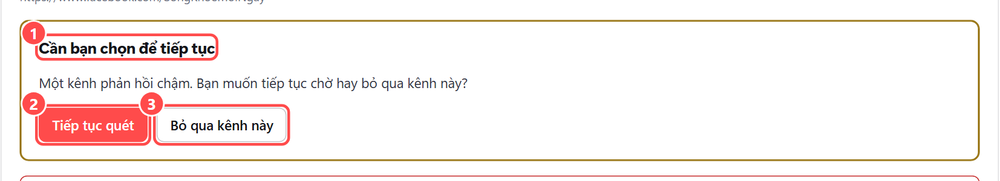

① Lý do đang chờ ② Tiếp tục quét ③ Bỏ qua kênh này.

### Theo dõi lượng dùng và diễn biến

Phần sử dụng dịch vụ cập nhật trong lúc chạy và giữ lại sau khi xong:

- **LLM:** model, số lần gọi, token, token trả về, thời gian chờ, tốc độ và số phân tích dùng lại. Thời gian chờ cộng dồn có thể lớn hơn thời gian quét vì xử lý song song.
- **Jev:** số lần gọi và token. **Deepgram:** số lần gọi và phút âm thanh.
- Biểu đồ sử dụng và bảng từng lượt giúp xem mục nào phát sinh lượng dùng. Nhận xét tổng hợp cuối lượt vẫn có thể gọi AI mới dù từng nội dung đã có cache.

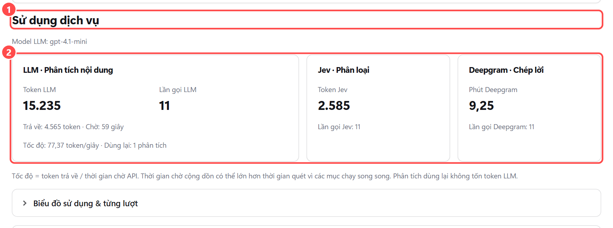

① Tiêu đề sử dụng dịch vụ ② Các thẻ lượng dùng LLM, Jev, Deepgram; số liệu minh họa không phải hóa đơn.

**Diễn biến gần nhất** giữ các thông báo mới nhất. Mở phần **Toàn bộ diễn biến lần quét** (tiêu đề có thêm số bước trong ngoặc) để xem đầy đủ. Nếu có lỗi, đọc nội dung và chụp phần thông báo đã che thông tin nhạy cảm khi cần hỗ trợ.

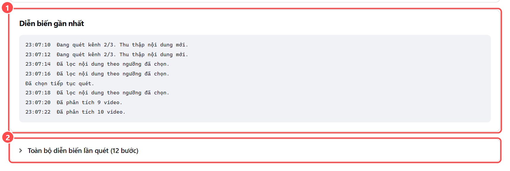

① Thông báo gần nhất ② Mở toàn bộ diễn biến.

### Dừng hoặc hoàn tất lượt quét

- Muốn dừng: bấm **Dừng quét** một lần, chờ chương trình hoàn tất bước hiện tại và lưu phần đã xử lý. Đừng tắt máy hoặc đóng trình duyệt quét trong lúc đang lưu.
- Khi xong: **Mở file Excel** để xem báo cáo, **Lưu bản sao…** để chọn nơi lưu khác, hoặc **Xem trong Kết quả** để xem thống kê trong ứng dụng.
- Bấm **Quét lần mới** khi muốn chỉnh tham số cho lượt sau. Các nội dung đã xử lý có thể được dùng lại, nhưng một số phần vẫn phát sinh phí mới.

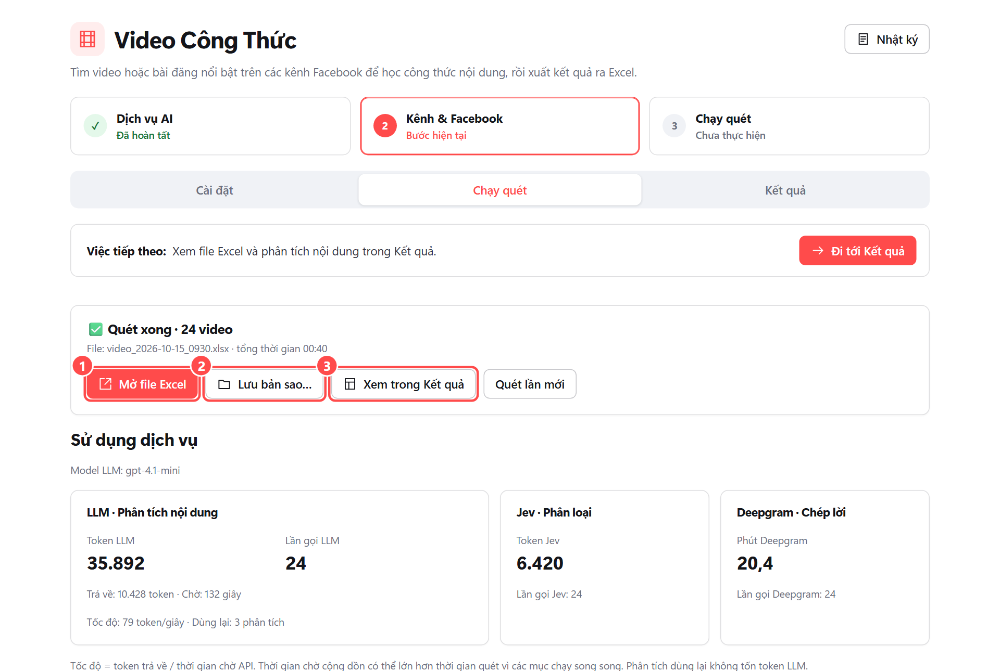

① Mở file Excel ② Lưu bản sao… ③ Xem trong Kết quả.

## 8. Kết quả & Excel

### Xem tổng quan và biểu đồ

Mở **Kết quả**, chọn **Xem thống kê file** (mặc định là file mới nhất). **Tổng quan kết quả** gồm số nội dung đã xuất, kênh có kết quả, tổng lượt xem hoặc tổng tương tác, điểm công thức trung bình và lượng dùng AI của file được chọn.

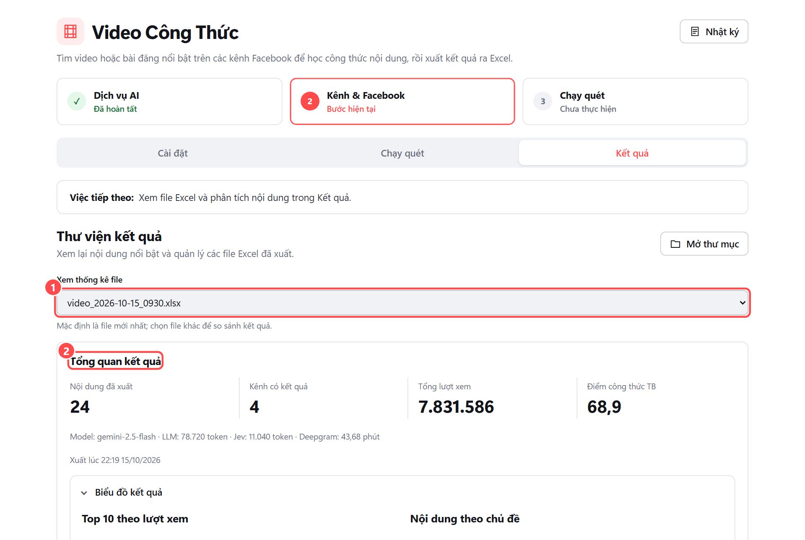

① Chọn file muốn xem ② Tổng quan của chính file được chọn.

**Biểu đồ kết quả** giúp nhìn nhanh nội dung đứng đầu, chủ đề phổ biến và phân bố điểm công thức. Biểu đồ không có dữ liệu sẽ hiện thông báo; bạn vẫn có thể mở báo cáo Excel nếu file đã có.

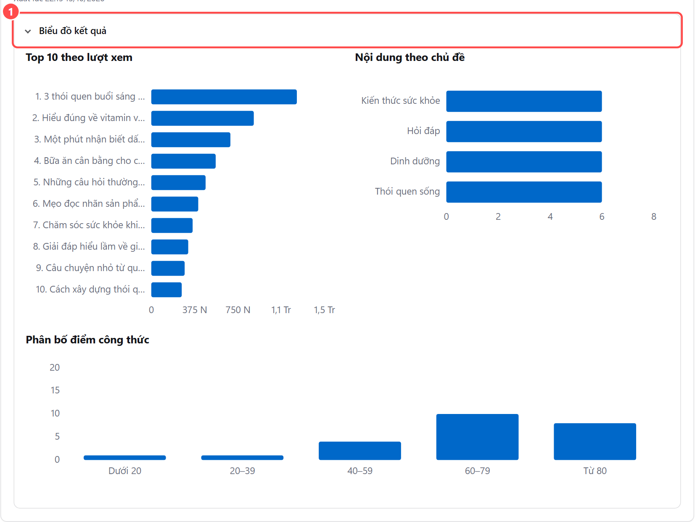

① Khu vực biểu đồ để so sánh nội dung, chủ đề và điểm.

### Mở, sao chép và xóa báo cáo

Trong **File Excel đã xuất**, file mới nhất nằm trước:

1. **Mở bằng Excel**: mở file gốc bằng chương trình đọc `.xlsx` của Windows.
2. **Lưu bản sao…**: chọn thư mục và tên trong hộp thoại Windows, rồi lưu. File gốc vẫn ở `output/`. Nên dùng bản sao khi muốn sửa số liệu hoặc chia sẻ.
3. **Mở thư mục**: mở nơi chứa toàn bộ báo cáo.
4. Biểu tượng thùng rác có chú thích **Xóa file**: đọc kỹ tên file trong hộp **Xóa file Excel**; bấm **Xóa** chỉ khi đúng file. Không thể khôi phục bằng ứng dụng. Muốn giữ thì hủy hộp thoại. Nếu file bị khóa, đóng trong Excel rồi thử lại.

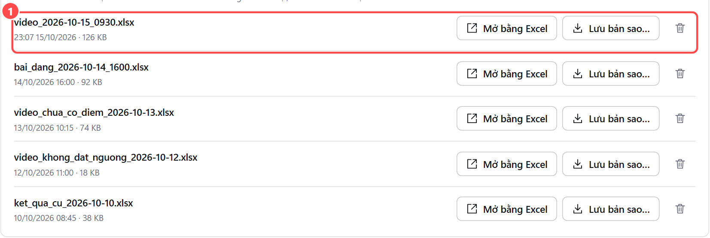

① Mỗi dòng có tên file và các nút mở Excel, lưu bản sao, xóa; kiểm tra đúng dòng trước khi thao tác.

### Ba trang tính trong Excel

File thường có dạng `cong-thuc_YYYY-MM-DD_HHmm.xlsx`; nếu trùng tên, chương trình thêm hậu tố để không ghi đè báo cáo trước. Các báo cáo có ba trang tính theo thứ tự:

| Trang tính | Nội dung và cách dùng |
| --- | --- |
| Chi tiết video / Chi tiết bài đăng | Mỗi dòng là một nội dung, xếp theo điểm công thức. Dùng bộ lọc ở dòng tiêu đề; bấm liên kết trong Link bài để đối chiếu nội dung gốc. |
| Tổng hợp công thức | Tổng hợp theo nhóm chủ đề, kiểu hook và cấu trúc, kèm nhận xét tổng hợp. Dùng để tìm xu hướng lặp lại giữa nhiều nội dung. |
| Nhật ký | Kết quả lượt chạy, số kênh, số mục quét được/đạt ngưỡng/đã phân tích/đã xuất, tham số, số liệu từng kênh, mức dùng dịch vụ và thông báo/lỗi. Dùng khi kết quả ít hoặc thiếu dữ liệu. |

### Đọc các nhóm cột chi tiết

| Nhóm | Các cột đáng chú ý | Cách hiểu |
| --- | --- | --- |
| Nguồn | Kênh, Follower kênh, Ngày đăng, Định dạng, Thời lượng (giây), Link bài | Xác định nơi đăng và mở lại bản gốc. |
| Hiệu quả | View, Cảm xúc, Bình luận, Chia sẻ, Tổng tương tác, View/Follower | So sánh quy mô tiếp cận và phản hồi; số thiếu không nên tự coi là 0. View/Follower hiển thị dạng phần trăm: 500% tương ứng 5×. |
| So sánh | Hệ số so trung vị kênh, Tỷ lệ tương tác, Tỷ lệ share | Dùng kèm số tuyệt đối, không kết luận chỉ từ một tỷ lệ cao khi mẫu nhỏ. |
| Nội dung | Chủ đề bài, Tóm tắt, Caption, Nội dung thoại, Ngôn ngữ thoại, Thoại dịch tiếng Việt | Phân biệt caption, lời nói gốc và bản dịch. Ngôn ngữ thoại có thể là Tiếng Việt, Tiếng Anh hoặc mã khác; trống là chưa biết. Bản dịch chỉ có khi thoại tiếng Anh được dịch thành công. |
| Công thức | Hook gốc, Góc nhìn, Mẫu hook điền chỗ trống, Vị trí CTA, Nhóm chủ đề, Kiểu hook, Độ mạnh hook, Cấu trúc, CTA | Học cách triển khai, không sao chép nguyên văn nội dung người khác. |
| Đánh giá | Liên quan ngành (%), Làm lại được (%), Điểm công thức (0–100), Điểm Jev (0–100), Cờ rủi ro | Điểm AI để ưu tiên đọc, không bảo đảm hiệu quả. Điểm Jev tổng hợp các đánh giá hook, cảm xúc, giá trị thực tiễn và khả năng chia sẻ. |
| Gợi ý | Lý do viral, Gợi ý 1, Gợi ý 2, Gợi ý 3, Ghi chú | Đọc lý do, kiểm tra gợi ý và các cảnh báo trước khi sản xuất nội dung mới. |

Báo cáo **Chi tiết bài đăng** ẩn các cột riêng cho video như lượt xem, thời lượng và lời thoại/ngôn ngữ/bản dịch. Khi có nội dung ảnh đã đọc, cột **Nội dung ảnh** được dùng thay phần thoại. Ô đỏ đánh dấu rủi ro; nhãn có thêm `(chưa chắc)` cần được xem lại. Không có thoại hoặc bản dịch không đồng nghĩa video không có người nói: có thể dịch vụ đã lỗi, hết hạn mức hoặc chưa xử lý được.

## 9. Mẹo & câu hỏi thường gặp

### Xử lý vấn đề thường gặp

| Hiện tượng | Bạn nên làm gì? |
| --- | --- |
| Key lỗi / không thể lưu dịch vụ | Kiểm tra đúng dịch vụ và đúng nhà cung cấp; dán lại không kèm khoảng trắng; kiểm tra key còn hiệu lực, quyền, số dư và endpoint. Làm đủ Kết nối → Kiểm tra và lưu, rồi Kiểm tra lại tại trang quét. Không gửi key cho hỗ trợ. |
| Deepgram hết credit | Ứng dụng báo: “Tài khoản Deepgram đã hết credit/hạn mức. Nạp thêm hoặc đổi key Deepgram trong Cài đặt rồi quét lại.” Các video đó không có transcript. Kiểm tra hạn mức ở Deepgram, nạp thêm hoặc đổi key rồi quét lại. |
| Facebook yêu cầu xác minh/checkpoint | Dừng quét. Tự xác minh trong trình duyệt bằng tài khoản phụ, sau đó nghỉ vài ngày trước khi quét lại. Không chạy đồng thời cùng tài khoản trên nhiều máy. |
| Không tìm thấy video / rất ít kết quả | Kiểm tra link có phải page công khai; khoảng ngày có quá ngắn; có chọn Video thường/Reel; thời lượng và ngưỡng có quá chặt. Thử một page, 30 ngày và ngưỡng thấp hơn, rồi đọc Nhật ký. Không giả định mọi nội dung đều thuộc loại được hỗ trợ. |
| Quét có vẻ đứng yên | Xem thông báo nghỉ 30–60 giây, tiến độ, diễn biến và câu hỏi đang chờ. Chờ mạng/AI phản hồi. Nếu kéo dài bất thường, lưu thông tin lỗi, dùng Dừng quét rồi chờ hoàn tất; không bấm bắt đầu nhiều lần. |
| SmartScreen chặn mở bộ cài | Chỉ khi chắc chắn tệp từ nguồn tin cậy: More info → Run anyway. Máy bị chính sách công ty chặn thì nhờ quản trị viên; không tắt phần mềm bảo vệ. |
| Thiếu WebView2 | Cài Microsoft Edge WebView2 Runtime từ liên kết Microsoft ở phần Cài đặt rồi mở lại. |
| Không chuẩn bị được trình duyệt quét | Kiểm tra Internet và dung lượng trống, mở lại ứng dụng. Nếu vẫn lỗi, cung cấp thông báo và nhật ký đã kiểm tra thông tin nhạy cảm. |
| Không mở/xóa được Excel | Đóng file đang mở trong Excel; kiểm tra phần mềm đọc .xlsx đã cài. Có thể Lưu bản sao… vào nơi bạn có quyền ghi. |
| Đổi máy nhưng không có key | Key nằm trong Windows Credential Manager, không nằm trong thư mục cấu hình để chép sang. Nhập lại key trên máy/tài khoản Windows mới. |
| Muốn tìm hoặc sao lưu dữ liệu | Xem vị trí và quy trình ở mục dưới. Không gửi nguyên bản sao lưu cho người khác vì có phiên đăng nhập. |

### Dữ liệu nằm ở đâu và sao lưu thế nào?

Bản Setup mặc định ở `%LOCALAPPDATA%\Programs\VideoCongThuc`. Có thể dán đường dẫn này vào thanh địa chỉ File Explorer. Bản ZIP dùng thư mục bạn đã giải nén. Bên cạnh EXE có:

| Thư mục | Chứa gì? | Lưu ý |
| --- | --- | --- |
| config/ | Cài đặt, danh sách kênh và tệp cấu hình | Không sửa JSON nếu không hiểu; dùng giao diện trước. |
| data/ | Cache, nhật ký và dữ liệu làm việc; có thể chứa fb_cookies.txt. Máy không có Edge thì Chromium tự tải (~150 MB) cũng nằm ở `data\browsers\` | Dữ liệu riêng tư, không chia sẻ cả thư mục. Không cần sao lưu `browsers\`: thiếu thì ứng dụng tự tải lại. |
| output/ | Báo cáo Excel | Mở nhanh bằng Mở thư mục ở Kết quả. |
| profile/ | Hồ sơ/phiên đăng nhập trình duyệt Facebook | Bảo vệ như thông tin đăng nhập. |
| app/ | Tệp chương trình và thư viện | Không tự sửa/xóa; thay qua bộ cài mới. |

**Sao lưu:** dừng quét, chờ lưu xong, đóng ứng dụng rồi sao chép `config/`, `data/`, `output/`, `profile/` đến nơi riêng tư có bảo vệ. Ghi ngày sao lưu để tránh nhầm bản. Giữ key trong nơi quản lý bí mật của bạn; chép bốn thư mục không sao lưu được key trong Windows Credential Manager. Khi khôi phục, đóng ứng dụng trước và giữ một bản dữ liệu hiện tại để tránh ghi đè nhầm.

### Nhật ký để nhờ hỗ trợ

1. Bấm **Nhật ký** ở góc trên bên phải để mở **Nhật ký ứng dụng**.
2. Mặc định **Chỉ lỗi và cảnh báo** được bật; tắt nếu cần xem cả thông báo thường. Dòng mới nhất ở trên.
3. Nếu cần lỗi lần mở trước, chọn **Lần mở trước** khi có.
4. Bấm **Mở file nhật ký**. File hiện tại là `data/app.log`. Key được che trong nhật ký, nhưng bạn vẫn cần đọc lại để tránh gửi link riêng hay dữ liệu nhạy cảm.
5. Khi báo lỗi, ghi bạn đang làm bước nào, thời điểm, thông báo chính xác và gửi phần nhật ký cần thiết. Không gửi `profile/`, `data/fb_cookies.txt`, key hoặc cả thư mục dữ liệu.

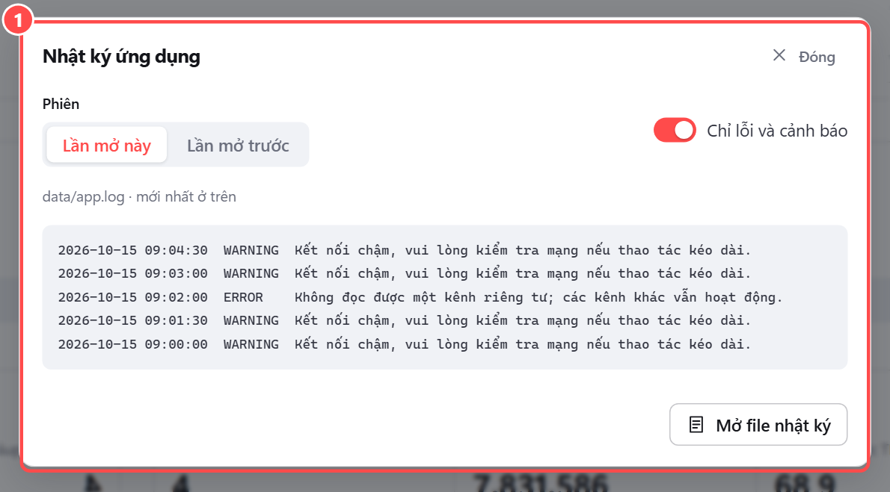

① Nhật ký ứng dụng: bộ lọc, phiên nhật ký và các thông báo để tra cứu lỗi.

### Làm việc tiết kiệm và giảm rủi ro

- Bắt đầu với ít kênh, 7 ngày; mở rộng sau khi đã đọc được báo cáo.
- Dùng giới hạn thời lượng và ngưỡng lọc hợp lý để tránh phân tích hàng loạt mục không cần.
- Không quét liên tục nhiều lượt trong ngày; không dùng cùng tài khoản trên nhiều máy đồng thời; tránh đổi quốc gia VPN/proxy giữa các lượt.
- Dữ liệu đã phân tích có thể dùng lại. Thay nhãn/mô tả hoặc các phần xử lý mới vẫn có thể phát sinh phí.
- Nếu Facebook đổi giao diện làm chương trình không đọc được, gửi nhật ký đã kiểm tra và chờ bản cập nhật từ người phát triển; không tự đoán bộ chọn hoặc cung cấp cookie để người khác thử.

## 10. Bảo mật

- **Không chia sẻ `profile/` hoặc `data/fb_cookies.txt`**. Hạn chế chia sẻ cả `data/`, vì có cache và dữ liệu riêng. Không đưa key/mật khẩu/cookie vào chat, email hoặc ảnh hướng dẫn.
- Key lưu trong Windows Credential Manager. Nếu nghi đã lộ, thu hồi key tại nhà cung cấp và tạo key mới, sau đó cập nhật trong Cài đặt. Đăng xuất/thu hồi phiên Facebook bị lộ qua các công cụ bảo mật của Facebook.
- Chỉ lấy nội dung bạn được phép truy cập; tuân thủ bản quyền, quyền riêng tư và [Điều khoản Facebook](https://www.facebook.com/terms). Thu thập tự động khi chưa được phép có thể trái điều khoản và khiến tài khoản bị hạn chế hoặc khóa. Tài khoản phụ và nhịp nghỉ chỉ giảm rủi ro, không bảo đảm an toàn.
- Nội dung/caption/âm thanh được gửi đến các dịch vụ AI phục vụ xử lý. Không quét tài liệu bí mật hoặc dữ liệu cá nhân nhạy cảm nếu chưa có quyền và chưa hiểu chính sách nhà cung cấp.
- Kiểm tra gợi ý AI trước khi công bố, nhất là nội dung sức khỏe, thuốc và quảng cáo. Không xem điểm số hay lời giải thích AI là chứng cứ chuyên môn.
- Muốn gửi chương trình cho người khác, gửi **bộ cài hoặc ZIP sạch từ nguồn phát hành**, không nén thư mục đang sử dụng vì có thể mang theo phiên đăng nhập của bạn.
